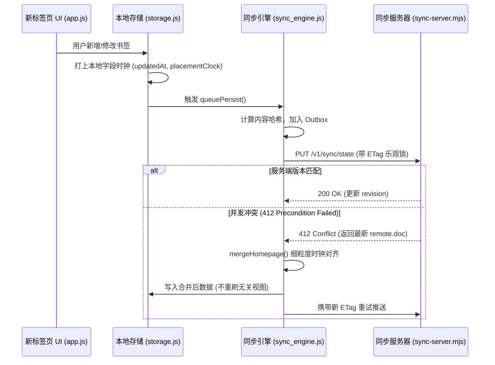

# 项目全景分析与下一步演进路线详细方案

> **归档编号**：`docs/20261103-2340-项目全景分析与下一步演进路线-Gemini-3.8-Flash.md`  
> **基线版本**：26.7.3  
> **制定日期**：2026-11-03  
> **编写模型**：Gemini-3.8-Flash (High)  

---

## 目录

- [一、 项目全景与多端架构深度解构](#一-项目全景与多端架构深度解构)
  - [1.1 核心业务定位与能力](#11-核心业务定位与能力)
  - [1.2 三端运行时架构与差异抹平](#12-三端运行时架构与差异抹平)
  - [1.3 数据架构与合并引擎（Local-first）](#13-数据架构与合并引擎local-first)
- [二、 技术债务与潜在隐患全景盘点](#二-技术债务与潜在隐患全景盘点)
  - [2.1 巨石模块风险：src/js/app.js 复杂度膨胀](#21-巨石模块风险-srcjsappjs-复杂度膨胀)
  - [2.2 权限隔离弱点：全局共享 Token 与缺乏按设备吊销](#22-权限隔离弱点-全局共享-token-与缺乏按设备吊销)
  - [2.3 构建链脆弱性：Firefox 依赖打平人工配置](#23-构建链脆弱性-firefox-依赖打平人工配置)
  - [2.4 存储与交互瓶颈：图标未压缩与搜索体验单一](#24-存储与交互瓶颈-图标未压缩与搜索体验单一)
- [三、 下一步开发详细方案（P0 ~ P3 落地实施全案）](#三-下一步开发详细方案p0--p3-落地实施全案)
  - [3.1 P0 阶段：架构解耦与工程防护网（立即实施）](#31-p0-阶段架构解耦与工程防护网立即实施)
    - [方案 3.1.1 模态框管理器（src/js/modal-manager.js）拆分方案](#方案-311-模态框管理器-srcjsmodal-managerjs-拆分方案)
    - [方案 3.1.2 上下文菜单管理器（src/js/context-menu.js）拆分方案](#方案-312-上下文菜单管理器-srcjscontext-menujs-拆分方案)
    - [方案 3.1.3 Firefox 模块打平拓扑自动推导与 CI 门禁](#方案-313-firefox-模块打平拓扑自动推导与-ci-门禁)
  - [3.2 P1 阶段：同步协议加固与安全闭环](#32-p1-阶段同步协议加固与安全闭环)
    - [方案 3.2.1 设备独立凭据（Per-Device Authentication）](#方案-321-设备独立凭据per-device-authentication)
    - [方案 3.2.2 生产墓碑代际回收（Tombstone Reclaim）常态化策略](#方案-322-生产墓碑代际回收tombstone-reclaim常态化策略)
    - [方案 3.2.3 设置面板同步健康度与多端状态视图](#方案-323-设置面板同步健康度与多端状态视图)
  - [3.3 P2 阶段：核心功能体验与生产力提升](#33-p2-阶段核心功能体验与生产力提升)
    - [方案 3.3.1 中文拼音首字母与模糊搜索引擎](#方案-331-中文拼音首字母与模糊搜索引擎)
    - [方案 3.3.2 Canvas 自定义图标自动压缩与 WebP 转换](#方案-332-canvas-自定义图标自动压缩与-webp-转换)
    - [方案 3.3.3 Popup 保存当前窗口所有标签页为新分组](#方案-333-popup-保存当前窗口所有标签页为新分组)
  - [3.4 P3 阶段：生态开放与跨平台延伸](#34-p3-阶段生态开放与跨平台延伸)
    - [方案 3.4.1 标准书签 HTML 与第三方导航站双向导入导出](#方案-341-标准书签-html-与第三方导航站双向导入导出)
    - [方案 3.4.2 独立 Web / PWA 离线运行模式](#方案-342-独立-web--pwa-离线运行模式)
- [四、 阶段里程碑与质量验收矩阵](#四-阶段里程碑与质量验收矩阵)

---

## 一、 项目全景与多端架构深度解构

### 1.1 核心业务定位与能力

「我的首页」定位为轻量、高速、跨浏览器且隐私优先的现代化新标签页扩展。核心支撑能力包括：
- **新标签页接管与卡片网格系统**：分组管理、无限层级文件夹、批量框选、触控/鼠标自由拖拽排序、快捷方式打开模式（本页/新页/后台）；
- **图标自愈与抓取体系**：多源 Favicon 嗅探、离线字母头像降级、孤儿图标静默回收；
- **动态背景支持**：Bing 每日壁纸缓存回退、渐变色、纯色及自定义本地背景；
- **多端可靠增量同步**：基于自建轻量级 HTTP JSON 服务的增量同步，无需依赖三方商业服务。

### 1.2 三端运行时架构与差异抹平

```
                  ┌───────────────────────────────────────────────┐
                  │          核心业务逻辑 (src/js/)                │
                  │  app.js / storage.js / sync_engine.js 等      │
                  └───────────────┬───────────────────────────────┘
                                  │
         ┌────────────────────────┼────────────────────────┐
         ▼                        ▼                        ▼
┌──────────────────┐    ┌──────────────────┐     ┌──────────────────┐
│   Chrome MV3     │    │   Firefox MV3    │     │    Safari App    │
│                  │    │                  │     │  (Web Extension) │
│ 原生 ESM 模块化  │    │ bundle-firefox   │     │ Native App Group │
│ background.js SW │    │ 打平为 app.ff.js │     │ 共享 JSON 文件   │
│ 本地 local 存储  │    │ 规避 strict CSP  │     │ 注册脚本自愈保活 │
└──────────────────┘    └──────────────────┘     └──────────────────┘
```

1. **Chrome / Edge (MV3)**：
   - 遵循标准 MV3 规范，直接使用 `<script type="module" src="js/app.js">` 加载原生 ESM 模块；
   - 依赖 `chrome.storage.local` 作为主持久化介质。
2. **Firefox (MV3)**：
   - Firefox 对扩展页面有着极严格的 CSP 策略，模块脚本动态加载或跨文件内联易被拦截；
   - 构建系统通过 `scripts/bundle-firefox.mjs`，根据 `scripts/firefox-modules.json` 声明的依赖次序，剥离 `import`/`export` 并合并为单一外部经典脚本 `dist/firefox/js/app.ff.js`。
3. **Safari (macOS App + Safari Web Extension)**：
   - 采用原生 Xcode 工程编译为 macOS 容器 App，内嵌 `.appex` 扩展；
   - 解决 Safari 重启后沙箱存储丢失与 7 天证书过期问题：通过共享 `~/Library/Application Support/我的首页/homepage-data.json` 建立外部权威文件存储通道；
   - 配套 `scripts/safari-repair-registration.sh`，解决 Safari 运行中热重装导致系统 `pluginkit` 丢失扩展注册的问题。

### 1.3 数据架构与合并引擎（Local-first）

系统以“本地数据为权威（Local-first）”为核心哲学，服务端仅作为数据同步中继与历史状态栅栏。



- **双层时钟机制**：
  - **属性时钟（Settings/Node Clocks）**：每个字段记录独立 `updatedAt` 和 `updatedBy`。若两端时钟打平，采用稳定的字典序值比较（`mergeSettingsByClock`），确保各端双向收敛到同一结果。
  - **结构时钟（Placement Clock）**：每个卡片记录父容器与排序位置的独立时钟，移动卡片不会覆盖其他设备对该卡片标题或内容的修改。
- **墓碑代际回收（Tombstone Reclaim）**：
  - 被删除卡片保留墓碑（Tombstone），防止旧设备上线时将其误当作“新书签”复活；
  - 服务端记录活跃设备确认的 revision，所有活跃设备均同步后，通过增加 `epoch` 栅栏将过期墓碑安全彻底清除。

---

## 二、 技术债务与潜在隐患全景盘点

### 2.1 巨石模块风险：src/js/app.js 复杂度膨胀

目前 `src/js/app.js` 行数高达 **3902 行**。内部混合了：
1. **视图渲染层**：`renderGrid()`, `renderGroups()`，手动构造几十处 DOM 字符串与节点；
2. **模态对话框状态机**（第 2112~2646 行，约 530 行）：添加卡片、修改卡片、打开方式选择、文件夹弹窗；
3. **右键菜单系统**（第 1720~1795 行）：右键弹窗计算位置、事件拦截与销毁；
4. **触控与拖拽逻辑**（第 1510~1719 行）：长按定时器、触控位置计算、DOM 镜像跟随；
5. **异步抓取子系统**（第 2709~2895 行）：Favicon 多候选试错、标题后台拉取。

**问题点**：多个子模块直接闭包访问外层的 `data`、`selectedIds`、`activeGroupId`，任何一处状态修改都可能引发意外副作用。

### 2.2 权限隔离弱点：全局共享 Token 与缺乏按设备吊销

- 目前同步服务 `sync-server.mjs` 依赖单个全局环境变量 `SYNC_TOKEN`；
- 所有设备（家里 Mac、公司 Windows、笔记本 Firefox）均配置完全相同的 Bearer Token；
- **隐患**：一旦某一设备的扩展或环境丢失，用户无法在服务端单独注销该设备，必须修改全局 Token 并手动更新所有终端；同时任何接入设备均拥有完全对等的读写权限。

### 2.3 构建链脆弱性：Firefox 依赖打平人工配置

- `scripts/firefox-modules.json` 手工定义了 23 个模块的打平顺序；
- 每次在 `src/js/` 中抽取或新增公共模块时，如果开发者忘记在 JSON 中同步声明，或者写错了依赖拓扑的前后顺序，Chrome 端由于原生 ESM 正常运行而不会报错，但 Firefox 打包产物会在运行时抛出 `ReferenceError: ... is not defined`。

### 2.4 存储与交互瓶颈：图标未压缩与搜索体验单一

- **图标存储占用**：用户自定义上传图标时，直接以原图 Base64 存储在 local 空间。上传多张 1MB+ 截图后，极易触发浏览器的存储上限告警。
- **搜索能力单一**：当前顶部搜索框仅对 `title` 和 `url` 执行原生的 `includes()` 子串过滤。对于中文书签，必须完整敲出汉字，无法通过“拼音首字母”（例如输入 `jd` 查找“京东”）或模糊分词快速定位。

---

## 三、 下一步开发详细方案（P0 ~ P3 落地实施全案）

---

### 3.1 P0 阶段：架构解耦与工程防护网（立即实施）

#### 方案 3.1.1 模态框管理器（src/js/modal-manager.js）拆分方案

- **目标**：从 `app.js` 抽离全部模态弹窗构建、表单校验与键盘行为逻辑，使 `app.js` 减少约 530 行代码。
- **模块定位**：`src/js/modal-manager.js`
- **对外暴露接口**：
  ```js
  export function createModalManager({
    getData,
    t,
    currentLang,
    onSaveNode,
    onUpdateNode,
    onClose
  }) {
    return {
      openAddModal(defaults = {}),
      openEditModal(node),
      openFolderModal(folderNode),
      closeActiveModal(),
      isModalOpen()
    };
  }
  ```
- **核心改造步骤**：
  1. 将 `parseModalHtml`, `openModal`, `closeModal`, `bindModalEnterToDefaultAction`, `openAddModal`, `openEditModal` 搬迁至 `modal-manager.js`；
  2. 模态框内部不再直接修改全局 `data`，而是触发 `onSaveNode({ type, title, url, icon, targetGroupId })` 等回调事件，由 `app.js` 统一接管持久化；
  3. 在 `scripts/firefox-modules.json` 的 `settings-controller.js` 之前注册 `modal-manager.js`；
  4. 运行全量单元测试与界面冒烟。

#### 方案 3.1.2 上下文菜单管理器（src/js/context-menu.js）拆分方案

- **目标**：抽离卡片右键菜单、分组右键菜单的定位与交互，使 `app.js` 减少约 150 行代码。
- **模块定位**：`src/js/context-menu.js`
- **核心能力**：
  - **视口防溢出计算**：根据 `window.innerWidth` 与 `window.innerHeight` 自动修正菜单出现坐标（向左/向上自适应展开）；
  - **事件生命周期托管**：统一监听全局 `click`、`contextmenu` 与 `keydown (Esc)`，保证单例菜单的自动回收。
- **接口设计**：
  ```js
  export function createContextMenuManager({ onAction }) {
    return {
      showTileMenu({ x, y, node, canUndo, isSelected }),
      showGroupMenu({ x, y, group, canDelete }),
      hideMenu()
    };
  }
  ```

#### 方案 3.1.3 Firefox 模块打平拓扑自动推导与 CI 门禁

- **目标**：彻底解决手工维护 `firefox-modules.json` 易遗漏、易错位的问题。
- **实施方案**：
  1. 在 `scripts/bundle-firefox.mjs` 中增加静态分析函数 `validateModuleTopology()`：
     - 利用正则/简单 AST 扫描 `src/js/app.js` 及其所有引用的直接与间接 `import` 语句；
     - 构建依赖有向无环图（DAG），并进行拓扑排序（Topological Sort）；
     - 对比生成的拓扑序列与 `firefox-modules.json`：
       - 若存在未在 JSON 中声明的模块，立即阻断并输出明确报错：`错误：模块 [foo.js] 在源码中被引用，但未在 firefox-modules.json 中登记！`；
       - 若声明顺序破坏了 DAG 依赖关系（被依赖项在后），同样告警阻断。
  2. 在 `npm run test` 与 `.github/workflows/ci.yml` 中接入该项静态检查。

---

### 3.2 P1 阶段：同步协议加固与安全闭环

#### 方案 3.2.1 设备独立凭据（Per-Device Authentication）

- **背景**：当前三端共用同一个全局 Bearer Token，无法实现单设备精准撤权。
- **改造方案**：
  ```
  [客户端设备 A]                           [同步服务器]
        │                                       │
        │── 1. POST /v1/sync/pair ─────────────>│  (携带主管理 Token + deviceId + 设备名称)
        │<── 2. 返回专属 deviceSecret ──────────│  (服务端记录于 deviceTable)
        │                                       │
        │── 3. PUT /v1/sync/state ─────────────>│  (请求头: Authorization: Device <deviceId>:<deviceSecret>)
        │<── 4. 200 OK ─────────────────────────│
  ```
- **服务端接口变更（`sync-server.mjs`）**：
  1. `deviceTable` 中为每个设备保存独立的哈希凭据：`{ id, name, tokenHash, registeredAt, retiredAt, lastSeenAt }`；
  2. 鉴权中间件升级：既兼容原有全局 `Bearer <MasterToken>`（用于管理操作或单机极简配置），又优先支持 `Device <deviceId>:<secret>`；
  3. 当管理员或某端调用 `POST /v1/sync/devices/:id/retire` 时，服务端废除该设备的 `tokenHash`，后续该设备发起读写直接返回 `403 Device Retired`。

#### 方案 3.2.2 生产墓碑代际回收（Tombstone Reclaim）常态化策略

- **背景**：已删除书签的墓碑（Tombstone）长期存在会占用传输与存储资源，需要平滑清理。
- **实施步骤**：
  1. 新增运维脚本 `scripts/run-tombstone-reclaim.sh`：
     - 自动请求 `POST /v1/sync/reclaim?dryRun=true`；
     - 检查服务端返回的 `candidates` 数量：若候选墓碑大于 0 且全部未退役设备的确认 revision 均已覆盖这些删除版本；
     - 输出核对报告后执行正式回收（安全推进 `epoch`）；
  2. 服务端在 `/health` 接口中暴露 `tombstoneCount` 和 `reclaimableCount` 指标，供外部监控检测。

#### 方案 3.2.3 设置面板同步健康度与多端状态视图

- **目标**：消除用户“同步到底成功没有”、“远端有多少台设备在协同”的信息差。
- **界面与功能设计**：
  - 在“设置 - 数据同步”面板中，将原有的单行文本扩展为**可折叠的健康度仪表盘**：
    - **同步状态灯**：绿色（实时在线）、黄色（有待推送队列）、红色（连接失败/鉴权错误）；
    - **活跃协同设备列表**：展示当前账户下登记的设备名、最后活跃时间、版本号；
    - **设备操作**：支持对失联已久的旧设备一键点击“标记退役”；
    - **队列调试**：直观展示本地 Outbox 积压条数与上次同步的耗时。

---

### 3.3 P2 阶段：核心功能体验与生产力提升

#### 方案 3.3.1 中文拼音首字母与模糊搜索引擎

- **目标**：在不引入大型三方库的前提下，实现零延迟的中文拼音首字母 + 汉字 + 网址模糊检索。
- **实现方案**：
  1. 新增轻量纯函数工具模块 `src/js/pinyin-match.js`（基于 GB2312 编码区段或常用一级汉字 Unicode 首字母码表，压缩后体积 $\le 4\text{KB}$）；
  2. 预处理索引：卡片加载后，提取标题的汉字首字母串存入内存缓存；
  3. 过滤规则：
     - 用户输入 `wyy` $\to$ 匹配“网易云音乐”；
     - 用户输入 `gh` $\to$ 匹配“GitHub”；
     - 用户输入 `bilibili` $\to$ 匹配 URL 中的 `bilibili.com`；
  4. 支持拼音高亮显示，显著提升卡片检索效率。

#### 方案 3.3.2 Canvas 自定义图标自动压缩与 WebP 转换

- **目标**：彻底规避上传高清壁纸/超大截屏作为图标导致的存储暴涨。
- **压缩管道**：
  ```js
  // 伪代码逻辑
  export async function compressUploadedIcon(file, maxDimension = 128, quality = 0.85) {
    const bitmap = await createImageBitmap(file);
    const canvas = document.createElement("canvas");
    let { width, height } = bitmap;
    if (width > maxDimension || height > maxDimension) {
      if (width > height) {
        height = Math.round((height * maxDimension) / width);
        width = maxDimension;
      } else {
        width = Math.round((width * maxDimension) / height);
        height = maxDimension;
      }
    }
    canvas.width = width;
    canvas.height = height;
    const ctx = canvas.getContext("2d");
    ctx.drawImage(bitmap, 0, 0, width, height);
    return canvas.toDataURL("image/webp", quality);
  }
  ```
- **效果**：将用户上传的 $1\text{MB}\sim 5\text{MB}$ 原始图片，无感压缩到 $6\text{KB}\sim 15\text{KB}$，兼顾 Retina 屏清晰度与极低存储消耗。

#### 方案 3.3.3 Popup 保存当前窗口所有标签页为新分组

- **用户价值**：在查阅多篇资料或同时打开大量相关网页时，一键保存当前上下文。
- **界面设计**：
  - 在 `src/popup.html` 顶部保留现有的“保存当前网页”；
  - 底部新增“一键暂存此窗口所有标签页（N 个）”按钮；
  - 点击后弹窗要求输入新分组名称（默认按当前时间或焦点网页命名），自动批量生成卡片并存入该分组。

---

### 3.4 P3 阶段：生态开放与跨平台延伸

#### 方案 3.4.1 标准书签 HTML 与第三方导航站双向导入导出

- **支持格式**：
  1. **Netscape Bookmark HTML**：各主流浏览器通用的标准导出格式，支持带层级文件夹导入；
  2. **JSON 数据包**：本项目的原生结构规范；
  3. **CSV / 纯网址列表**：单行文本快捷导入。
- **导入机制**：复用现有的 `mergeHomepage()`，只做追加合并，不抹除本地已有配置。

#### 方案 3.4.2 独立 Web / PWA 离线运行模式

- **目标**：在没有安装扩展的设备（如 iOS Safari、Android Chrome、公共电脑）上，通过浏览器直接访问静态页面，输入同步地址和 Token 即可获得完全一致的首页体验。
- **技术基础**：
  - 核心逻辑 `src/js/` 均基于标准 Web API 编写；
  - 存储层已在 `storage.js` 中抽象了 `chrome.storage` 与 `localStorage` / 共享文件的抹平；
  - 配合 `manifest.webmanifest` 与 Service Worker 即可实现完整的 PWA 体验。

---

## 四、 阶段里程碑与质量验收矩阵

| 阶段 | 交付物 | 关键验收指标 | 预期耗时 |
|---|---|---|---|
| **P0: 架构解耦** | 1. `src/js/modal-manager.js`<br>2. `src/js/context-menu.js`<br>3. `bundle-firefox` 依赖拓扑校验 | - `app.js` 行数降至 3300 行以内<br>- 262 项现有测试 100% 通过<br>- Chrome/Firefox/Safari 三端功能无回归 | 1~2 天 |
| **P1: 安全与治理** | 1. 服务端设备独立秘钥<br>2. 设置面板同步健康度视图<br>3. 墓碑定时回收演练脚本 | - 退役设备写入被 403 阻断<br>- 墓碑成功推进 epoch 且客户端平滑更新<br>- 面板直观展示设备列表 | 1~2 天 |
| **P2: 核心体验** | 1. 拼音首字母搜索模块<br>2. 图标上传 Canvas 自动压缩<br>3. Popup 窗口标签页全量归档 | - 拼音首字母毫秒级响应<br>- 上传图标体积 $\le 20\text{KB}$<br>- 一键归档 10+ 标签页为分组正常工作 | 2~3 天 |
| **P3: 生态开放** | 1. HTML 标准书签导入导出<br>2. PWA 纯前端静态接入模式 | - 成功导入 Chrome 导出的 HTML 书签树<br>- 移动端浏览器无需扩展即可离线加载并同步 | 2~3 天 |

---

## 五、 总结与即刻行动建议

本项目已经走过了“功能从无到有”以及“多端同步核心冲突收敛（26.0~26.7）”的最艰深阶段。目前代码体系健全、测试屏障扎实。

当前的最佳工程切入点为 **P0 阶段的模块拆分与解耦**：
1. 优先实施 `modal-manager.js` 与 `context-menu.js` 拆分；
2. 固化 Firefox 构建依赖自动推导门禁；
3. 为后续接入拼音模糊搜索与多端安全凭据扫清架构障碍。
